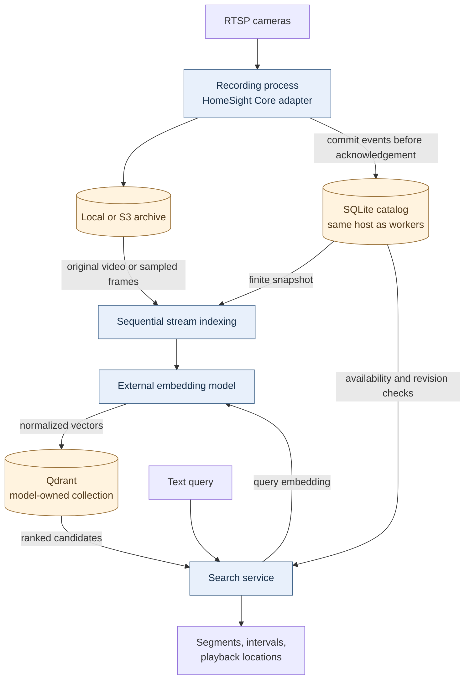
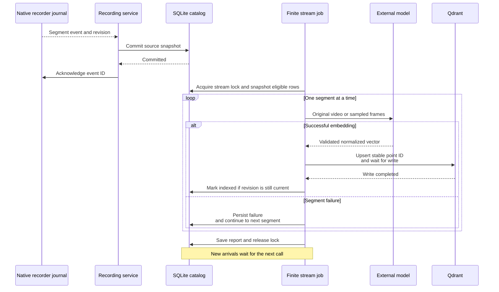

# HomeSight Analytics

Record camera footage continuously, index stored segments with an externally served embedding model, and search them by text. The Python library composes [HomeSight Core](https://github.com/peghaz/homesight-video-consumer/tree/v0.1.1), a host-local SQLite catalog, and Qdrant. It does not load model weights or require a task framework.

## Quick start

After [installing the Fedora prerequisites](user-guide.md#installation), run these commands from the repository root:

```sh
uv sync
cp .env.example .env
# Set the camera URL in .env and model, dimension, and Qdrant in the TOML file.
docker compose up -d qdrant
uv run cli.py record configs/example.toml --env-file .env
```

Leave recording running. In another terminal, index the current snapshot and search it:

```sh
uv run cli.py index configs/example.toml --camera front_door --env-file .env
uv run cli.py search configs/example.toml "person carrying a bag" --env-file .env
```

The model server must support the configured video/frame input and text queries in the same embedding space. For a wiring check without a camera, model server, or Qdrant server, run the [offline example](user-guide.md#offline-example).

For an interactive end-user walkthrough, start the [test Qdrant interface](user-guide.md#start-the-test-qdrant-interface), then follow the [notebook guide](user-guide.md#notebook-walkthrough). It reuses your Core S3 settings under `S3_*` variable names and runs direct finite jobs.

## Guides and reference

```{toctree}
:maxdepth: 2

user-guide
integration
development
python-api
```

The user guide covers operation and configuration. The integration guide covers ownership and backend adapters. The developer guide covers package structure and verification. The Python reference reads signatures and docstrings from the installed package; the consumer maintains the [native C++ reference](https://github.com/peghaz/homesight-video-consumer/blob/v0.1.1/docs/cpp-api.rst).

## Architecture

Recording runs independently of the model and vector store. Indexing, search, and retention share the catalog on the recorder's host. Scroll wide diagrams horizontally or use the fullscreen control (⛶) in the HTML site.



Native journals preserve recording work and unacknowledged events. The catalog owns indexing, reanalysis, and retention state; Qdrant stores searchable vectors. These are separate persistence layers. Their [recovery rules](integration.md#finite-jobs-and-celery) allow repeated work after a crash while suppressing stale search results.

## Event and indexing lifecycle



## Documentation builds

No cameras, model servers, or optional S3/Triton extras are needed to generate this site. The installed native consumer and its system libraries are still required for imports.

```sh
uv sync --group docs
uv run --group docs sphinx-build -W --keep-going -b html docs build/docs/html
```

Open `build/docs/html/index.html`. See [development](development.md#documentation-builds) for checks and renderer requirements.
